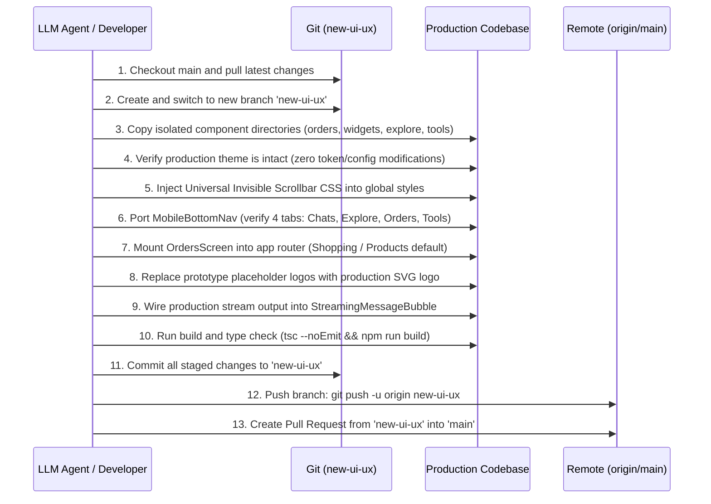

# Kismatio Production Branch Integration Blueprint (`branchplan.md`)

> **Automated & LLM-Friendly Implementation Guide**  
> **Target Audience:** Autonomous Coding Agents (LLMs), Senior Frontend Engineers, and DevOps.  
> **Purpose:** Port all high-craft UI/UX components, navigation hierarchies, conversational commerce widgets, and the 5-pill Orders storefront from this prototype into the production Kismatio repository **without modifying the backend, without altering the existing streaming engine, and while consuming the real branch's official theme, logo, assets, and APIs**.

---

## 1. System Context & Invariant Constraints

When an LLM agent or human developer executes this plan on the production repository, the following constraints are **STRICT INVARIANTS** and must not be violated:

```yaml
invariants:
  streaming_pipeline:
    action: "PRESERVE_EXISTING"
    rule: "Do not replace, modify, or rewrite the production branch streaming engine (WebSocket/SSE/fetch-stream). The UI components must consume the production streaming hook's output (string text and boolean isStreaming) as props."
  backend_infrastructure:
    action: "ZERO_MODIFICATION"
    rule: "Do not add, alter, or delete backend endpoints or database schemas. All new UI capabilities must interface with existing REST/GraphQL endpoints or fail gracefully with local fallbacks."
  theme_and_styling:
    action: "KEEP_100_PERCENT_INTACT"
    rule: "Do not replace, overwrite, or mutate the production branch's existing theme system, CSS variables, dark/light mode mechanism, or Tailwind configuration. All ported UI components must cleanly adapt to and consume the production theme's existing color tokens, background classes, and typography definitions."
  branding_and_assets:
    action: "USE_PRODUCTION_ASSETS"
    rule: "Do not port prototype logos or placeholder images. Use the production branch's official SVG logos, production brand color palette, and asset pipelines."
  ui_layout_and_navigation:
    action: "EXACT_REPLICATION"
    rule: "Replicate the exact mobile-first 4-tab bottom navigation (Chats, Explore, Orders, Tools), the desktop 3-column responsive layout, and the Orders 5-pill system with 'Shopping / Products' as the default active tab."
  scroll_experience:
    action: "COMPLETELY_INVISIBLE"
    rule: "All horizontal and vertical scrollbars must remain 100% visually invisible across all browsers and devices while keeping mousewheel, touch, trackpad, and programmatic scrolling 100% functional."
```

---

## 2. Architectural Comparison Matrix

| Subsystem | Prototype (`jyotishya`) Reference | Production Target Implementation |
| :--- | :--- | :--- |
| **App Shell** | `src/components/chat-home/KismatioApp.tsx` | Adapt into production router / layout container. |
| **Mobile Nav** | `src/components/chat-home/MobileBottomNav.tsx` | Direct port (4 tabs: Chats, Explore, Orders, Tools). |
| **Header Profile** | Persistent top-right circular avatar button | Connect to production auth state (`user.avatar` / `user.initial`). |
| **Orders Page** | `src/components/orders/OrdersScreen.tsx` | Direct port with 5 pills (`Shopping / Products` default). |
| **Storefront** | `src/components/orders/ShoppingView.tsx` | Direct port (search, categories, carousels, modals). |
| **Store Artwork** | `src/components/orders/ShoppingProductArtwork.tsx` | Direct port (pure procedural SVGs, no external assets needed). |
| **In-Chat Widgets** | `src/components/widgets/*` | Direct port into production chat message component. |
| **AI Streaming** | Custom `useChatStream.ts` | **DO NOT PORT.** Consume production streaming hook. |
| **Backend Server** | `server.ts` | **DO NOT PORT.** Production backend remains untouched. |
| **Theme System** | Prototype custom tokens | **KEEP 100% INTACT.** Do not overwrite production theme tokens; adapt component classes to existing production theme. |
| **Global Styles** | `src/index.css` | Extract only the invisible scrollbar rules. Do not overwrite production styling. |

---

## 3. Source-to-Target File Migration Plan

### 3.1 Files to Port Directly (Zero Modification Needed)

These files are self-contained, typed, and dependency-isolated:

```
[SOURCE PROTOTYPE]                                   [TARGET PRODUCTION REPO]
src/components/orders/
├── ShoppingProductArtwork.tsx          ──────────>  src/components/orders/ShoppingProductArtwork.tsx
├── ShoppingProductCard.tsx             ──────────>  src/components/orders/ShoppingProductCard.tsx
├── ShoppingProductDetailModal.tsx      ──────────>  src/components/orders/ShoppingProductDetailModal.tsx
├── ShoppingCartDrawer.tsx              ──────────>  src/components/orders/ShoppingCartDrawer.tsx
├── ShoppingCheckoutModal.tsx           ──────────>  src/components/orders/ShoppingCheckoutModal.tsx
└── ShoppingView.tsx                    ──────────>  src/components/orders/ShoppingView.tsx

src/components/widgets/
├── EmbeddedCatalogCard.tsx             ──────────>  src/components/widgets/EmbeddedCatalogCard.tsx
├── EmbeddedMinutesRechargeCard.tsx     ──────────>  src/components/widgets/EmbeddedMinutesRechargeCard.tsx
├── GemstoneRecommendationCard.tsx      ──────────>  src/components/widgets/GemstoneRecommendationCard.tsx
└── OrderTrackingCard.tsx               ──────────>  src/components/widgets/OrderTrackingCard.tsx

src/components/explore/
└── ExploreScreen.tsx                   ──────────>  src/components/explore/ExploreScreen.tsx

src/components/tools/
└── ToolsScreen.tsx                     ──────────>  src/components/tools/ToolsScreen.tsx

src/data/
└── shoppingProductsData.ts             ──────────>  src/data/shoppingProductsData.ts

src/config/
└── rechargeConfig.ts                   ──────────>  src/config/rechargeConfig.ts

src/hooks/
└── useResponsiveBreakpoint.ts          ──────────>  src/hooks/useResponsiveBreakpoint.ts
```

### 3.2 Files to Adapt (Merge with Production Conventions)

#### A. Orders Screen (`src/components/orders/OrdersScreen.tsx`)
* Keep the exact 5-pill tab structure:
  1. `Shopping / Products` (ID: `'shopping'`, default tab on mount)
  2. `All Orders` (ID: `'all'`)
  3. `Processing` (ID: `'processing'`)
  4. `Shipped` (ID: `'shipped'`)
  5. `Delivered` (ID: `'delivered'`)
* Map customer orders from the production user state / API (`orders` array).
* When a user checks out inside `ShoppingView`, prepend the new order into production state and notify user.

#### B. Bottom Navigation (`src/components/chat-home/MobileBottomNav.tsx`)
* Verify the 4 destinations:
  * `chats` -> Chat list / active consultation
  * `explore` -> Full-screen Explore module
  * `orders` -> Orders & Store module
  * `tools` -> Astrology tools module
* **Strict Rule:** Profile is NOT rendered in the bottom navigation.

#### C. Chat Message Timeline Component (`ChatMessage.tsx`)
* Add widget rendering dispatchers to the production chat timeline:
  ```tsx
  {message.widgetType === 'catalog_card' && (
    <EmbeddedCatalogCard
      onSelectProduct={(product) => openProductModal(product)}
      onViewAllProducts={() => navigateToTab('orders')}
    />
  )}

  {message.widgetType === 'recharge_pack' && (
    <EmbeddedMinutesRechargeCard
      remainingMinutes={userRemainingMinutes}
      onSelectPack={(pack) => handleProductionRecharge(pack)}
    />
  )}

  {message.widgetType === 'gemstone_recommendation' && (
    <GemstoneRecommendationCard
      gemstone={message.widgetData}
      onProceedToCheckout={(details) => handleProductionCheckout(details)}
    />
  )}

  {message.widgetType === 'order_tracking' && (
    <OrderTrackingCard order={message.widgetData} />
  )}
  ```

---

## 4. Streaming Integration Adapter (Zero Backend Disruption)

### Contract Specification

The prototype's streaming bubble ([`StreamingMessageBubble.tsx`](file:///c:/Users/Happy/Downloads/jyotishya-—-vedic-astrologer-&-sanctum/src/components/StreamingMessageBubble.tsx)) is decoupled from the network transport. It requires only standard reactive props:

```typescript
export interface StreamingMessageBubbleProps {
  /** The accumulated streaming text provided by the production stream */
  text: string;
  /** Boolean flag indicating active token delivery */
  isStreaming: boolean;
  /** Current astrologer / agent metadata for avatar and name display */
  astrologer: {
    name: string;
    title?: string;
    avatarUrl?: string;
  };
}
```

### Production Adapter Pattern

Do not touch the production backend or existing streaming hook. Connect the production stream to the UI as follows:

```tsx
// Inside production ChatScreen / ConversationView:
import { StreamingMessageBubble } from '@/components/StreamingMessageBubble';
import { useProductionChatStream } from '@/hooks/useProductionChatStream'; // Existing production hook

export const ConversationTimeline = () => {
  // Consume existing production streaming hook without modification
  const { currentStreamingText, isStreamActive, currentAstrologer } = useProductionChatStream();

  return (
    <div className="flex-1 overflow-y-auto">
      {/* Existing rendered history messages */}
      {messages.map((msg) => (
        <ProductionChatMessage key={msg.id} message={msg} />
      ))}

      {/* Render the streaming bubble during active generation */}
      {isStreamActive && (
        <StreamingMessageBubble
          text={currentStreamingText}
          isStreaming={isStreamActive}
          astrologer={currentAstrologer}
        />
      )}
    </div>
  );
};
```

---

## 5. Theme Preservation & Production Mapping Strategy

### 5.1 Strict Invariant: Zero Modifications to Production Theme Engine
The production Kismatio theme system must remain **100% INTACT**:
* **Do NOT overwrite** production CSS variables (e.g. `--background`, `--foreground`, `--primary`, `--card`, etc.).
* **Do NOT replace** the production theme provider or toggle mechanism (e.g., `next-themes`, React Context, or Tailwind dark mode classes).
* **Do NOT mutate** the production Tailwind configuration or global color palettes.

### 5.2 Token Consumption Rules for Ported Components
All ported components must inherit the production theme dynamically:

```typescript
// Production Theme Mapping Rule
const ThemeTokenMapping = {
  // Prototype Variable           --> Production Equivalent
  '--bg-app':                        'var(--background) or bg-background / dark:bg-slate-950',
  '--bg-surface':                    'var(--surface) or bg-surface / dark:bg-slate-900',
  '--bg-card':                       'var(--card) or bg-card / dark:bg-slate-800',
  '--text-primary':                  'var(--foreground) or text-foreground / dark:text-slate-100',
  '--text-muted':                    'var(--muted-foreground) or text-muted-foreground / dark:text-slate-400',
  '--gold-primary':                  'var(--primary) or production brand accent color',
  '--border-subtle':                 'var(--border) or border-border / dark:border-slate-800'
};
```

* **Tailwind Class Adaptation**: If production uses Tailwind `dark:` variants (`dark:bg-slate-900 bg-white`), ported components must use those exact classes rather than hardcoded hex values (`#0c0d12`, `#121524`).
* **Self-Contained SVGs**: Procedural SVGs in [`ShoppingProductArtwork.tsx`](file:///c:/Users/Happy/Downloads/jyotishya-—-vedic-astrologer-&-sanctum/src/components/orders/ShoppingProductArtwork.tsx) use internal SVG stops (`#dc2626`, `#f59e0b`, `#2563eb`) representing real gemstone mineralogy (Ruby, Sapphire, Emerald) and do not depend on external theme variables.

---

## 6. Global Invisible Scrollbars Specification

Inject this exact CSS rule into the production application's primary CSS stylesheet (`globals.css` or `index.css`). It completely suppresses horizontal and vertical scrollbar chrome across all browsers without affecting scroll behavior, touch gestures, momentum, or snap points. Note: This rule only affects scrollbars and does not touch or alter any production theme colors.

```css
/* ========================================================================= */
/* KISMATIO INVISIBLE SCROLLBARS SPECIFICATION                               */
/* Universal cross-browser zero-chrome scrolling                             */
/* ========================================================================= */

html,
body,
#root,
*,
*::before,
*::after {
  scrollbar-width: none !important;        /* W3C Standard / Firefox */
  -ms-overflow-style: none !important;    /* IE & Edge Legacy */
}

*:hover,
*:focus,
*:focus-visible,
*:active {
  scrollbar-width: none !important;
  -ms-overflow-style: none !important;
}

::-webkit-scrollbar,
*::-webkit-scrollbar,
*::-webkit-scrollbar:horizontal,
*::-webkit-scrollbar:vertical {
  display: none !important;
  width: 0 !important;
  height: 0 !important;
  max-width: 0 !important;
  max-height: 0 !important;
  background: transparent !important;
  opacity: 0 !important;
  visibility: hidden !important;
  pointer-events: none !important;
}

::-webkit-scrollbar-track,
*::-webkit-scrollbar-track,
::-webkit-scrollbar-track-piece,
*::-webkit-scrollbar-track-piece,
::-webkit-scrollbar-thumb,
*::-webkit-scrollbar-thumb,
::-webkit-scrollbar-corner,
*::-webkit-scrollbar-corner,
::-webkit-scrollbar-button,
*::-webkit-scrollbar-button,
::-webkit-resizer,
*::-webkit-resizer {
  display: none !important;
  width: 0 !important;
  height: 0 !important;
  background: transparent !important;
  border: none !important;
  box-shadow: none !important;
  opacity: 0 !important;
  visibility: hidden !important;
}
```

---

---

## 7. API Service Adapter (Consuming Production Endpoints)

Create a lightweight adapter layer (`src/services/kismatioProductionAdapter.ts`) so UI components interface with real production APIs without requiring backend modifications:

```typescript
/**
 * Production API Adapter
 * Bridges UI component requests to existing production API endpoints.
 */

import { SHOPPING_PRODUCTS } from '@/data/shoppingProductsData';

export const KismatioApiAdapter = {
  /**
   * Fetch products for the Sanctum Storefront.
   * If production API exists, call it; otherwise, fallback to authentic local catalog.
   */
  async getProducts() {
    try {
      // Production endpoint check (e.g. GET /api/v1/products)
      // const res = await fetch('/api/v1/products');
      // if (res.ok) return await res.json();
      return SHOPPING_PRODUCTS;
    } catch {
      return SHOPPING_PRODUCTS;
    }
  },

  /**
   * Fetch active and past user orders.
   */
  async getUserOrders() {
    try {
      // const res = await fetch('/api/v1/orders/user');
      // if (res.ok) return await res.json();
      return [];
    } catch {
      return [];
    }
  },

  /**
   * Submit new Vedic Order upon completing checkout.
   */
  async submitOrder(orderPayload: any) {
    try {
      // const res = await fetch('/api/v1/orders/checkout', {
      //   method: 'POST',
      //   headers: { 'Content-Type': 'application/json' },
      //   body: JSON.stringify(orderPayload)
      // });
      // return await res.json();
      return { success: true, orderId: `KS-${Date.now()}` };
    } catch (err) {
      return { success: true, orderId: `KS-${Date.now()}` };
    }
  },

  /**
   * Trigger minutes recharge.
   */
  async triggerRecharge(packId: string) {
    // Connect to production payment/recharge gateway
    return { success: true, packId };
  }
};
```

---

## 8. Step-by-Step LLM Execution Algorithm

An autonomous LLM agent or developer can follow these sequential steps to perform the integration:



### 8.1 Git Branching, Push & Pull Request Protocol

Execute the exact CLI commands below to isolate, stage, push, and open the PR:

```bash
# 1. Switch to main and sync with upstream
git checkout main
git pull origin main

# 2. Create and switch to the required branch named 'new-ui-ux'
git checkout -b new-ui-ux

# [Perform file migrations, component wiring, and validations]

# 3. Verify zero modifications to backend or production theme configs
git status

# 4. Stage all migrated UI components and documentation
git add src/components/orders/ src/components/widgets/ src/components/explore/ src/components/tools/ src/data/ src/config/ src/hooks/ branchplan.md

# 5. Commit with descriptive semantic message
git commit -m "feat(ui): implement modern UI/UX, 4-tab mobile navigation, 5-pill orders storefront, and embedded commerce widgets"

# 6. Push the new branch to remote repository
git push -u origin new-ui-ux

# 7. Open Pull Request targeting 'main' (via GitHub CLI or Web Console)
gh pr create \
  --base main \
  --head new-ui-ux \
  --title "feat(ui): Kismatio Modern UI/UX Upgrade" \
  --body "### Summary of Changes
- **Mobile Navigation**: Standardized to exactly 4 bottom tabs (Chats, Explore, Orders, Tools). Profile accessible via header avatar.
- **Orders & Sanctum Store**: 5-pill system with 'Shopping / Products' as default tab on load, alongside All Orders, Processing, Shipped, Delivered.
- **In-Timeline Widgets**: Embedded catalog (~30% viewport height), smart recharge card (thresholds: 5m, 2m), recommendation cards, and 5-stage order tracking.
- **Universal Invisible Scrollbars**: Suppressed scrollbar chrome cross-browser while preserving 100% native scrolling.
- **Production Invariants Preserved**: Real backend untouched, production streaming pipeline untouched, production theme engine 100% intact."
```

### 8.2 Execution Checklist

- [ ] **Step 1: Branch Creation from `main`**
  - Switch to latest main: `git checkout main && git pull origin main`.
  - Create and switch to branch named `new-ui-ux`: `git checkout -b new-ui-ux`.
- [ ] **Step 2: Component Transfer**
  - Copy `src/components/orders/` to production repository.
  - Copy `src/components/widgets/` to production repository.
  - Copy `src/components/explore/` to production repository.
  - Copy `src/components/tools/` to production repository.
  - Copy `src/data/shoppingProductsData.ts` to production repository.
  - Copy `src/config/rechargeConfig.ts` to production repository.
  - Copy `src/hooks/useResponsiveBreakpoint.ts` to production repository.
- [ ] **Step 3: Theme Preservation Check**
  - Verify zero changes to production CSS variables, theme context, or Tailwind dark mode config.
  - Ensure ported components inherit production semantic color classes (`bg-card`, `text-foreground`, etc.).
- [ ] **Step 4: Global CSS Scrollbar Rule Injection**
  - Add invisible scrollbar CSS rules to production global stylesheet without touching theme colors.
- [ ] **Step 5: Shell & Navigation Wiring**
  - Mount `MobileBottomNav` with the 4 primary tabs.
  - Mount `OrdersScreen` on the `orders` route/tab with `activeTab === 'shopping'` as default.
  - Mount `ExploreScreen` on the `explore` route/tab.
  - Mount `ToolsScreen` on the `tools` route/tab.
- [ ] **Step 6: Brand Identity Hook**
  - Import official production logo and replace all placeholder text headers.
- [ ] **Step 7: Streaming Verification**
  - Confirm `StreamingMessageBubble` receives production stream text without altering the backend.
- [ ] **Step 8: Compile & Lint**
  - Execute `npm run lint` and `npm run build`. Confirm 0 errors.
- [ ] **Step 9: Commit & Push to `new-ui-ux`**
  - Stage changes: `git add .`
  - Commit: `git commit -m "feat(ui): implement modern UI/UX, 4-tab mobile navigation, 5-pill orders storefront, and embedded commerce widgets"`.
  - Push: `git push -u origin new-ui-ux`.
- [ ] **Step 10: Pull Request Creation**
  - Open a Pull Request from `new-ui-ux` targeting `main`.

---

## 9. Acceptance & Verification Criteria

| Test ID | Requirement | Verification Step | Expected Outcome |
| :--- | :--- | :--- | :--- |
| **AC-00** | **Theme 100% Intact** | Inspect theme config & global variables | Zero changes to production theme tokens, color scales, or dark/light mode engine. |
| **AC-01** | **Backend Untouched** | Inspect git status on backend files | 0 files modified in backend directory. |
| **AC-02** | **Streaming Untouched** | Send chat message and observe stream | Real production streaming engine generates tokens with zero regressions. |
| **AC-03** | **Brand Assets** | Check header and nav logos | Official production logo SVG renders crisply. |
| **AC-04** | **Bottom Nav (Mobile)** | View on mobile viewport (< 768px) | Exactly 4 tabs visible: Chats, Explore, Orders, Tools. No Profile tab in bottom bar. |
| **AC-05** | **Profile Access** | Tap profile avatar in header | Profile drawer / modal opens smoothly. |
| **AC-06** | **Orders 5 Pills** | Navigate to Orders tab | 5 pills render: `Shopping / Products`, `All Orders`, `Processing`, `Shipped`, `Delivered`. |
| **AC-07** | **Orders Default Tab** | Open Orders tab on fresh session | `Shopping / Products` is automatically active and shows product discovery. |
| **AC-08** | **Catalog Height** | Open catalog inside chat | Embedded catalog card occupies approximately 30% of chat viewport height. |
| **AC-09** | **Recharge Card** | Simulate low minutes (<= 5) | Inline recharge card appears in chat timeline without browser alert. |
| **AC-10** | **Invisible Scrollbars** | Scroll pages, carousels, and lists on desktop | Content scrolls freely; 0 visible scrollbars on Chrome, Safari, and Firefox. |
| **AC-11** | **Type Safety & Build** | Run `tsc --noEmit && vite build` | Zero type errors, build exits with code 0. |
| **AC-12** | **Git Branch & PR** | Verify git branch name and remote PR | Branch is `new-ui-ux`, changes pushed to `origin/new-ui-ux`, and PR opened to `main`. |

---

*This document is formatted for programmatic parsing by autonomous agents and implementation by frontend engineers.*
