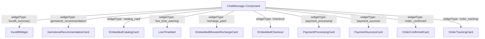
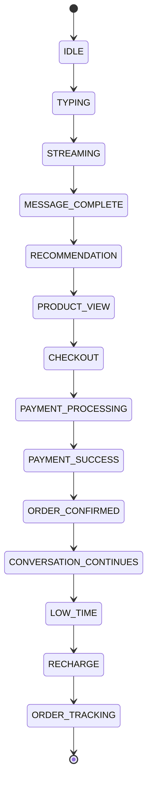

# Kismatio (Jyotishya) UI/UX & System Architecture Blueprint

> **Complete Implementation & Replication Guide (`plan.md`)**  
> *A comprehensive architectural reference and design system manual for engineering luxury conversational commerce applications, spiritual/consultation products, and real-time streaming interfaces.*

---

## Table of Contents

1. [Executive Summary & Product DNA](#1-executive-summary--product-dna)
2. [Full Technology Stack & System Architecture](#2-full-technology-stack--system-architecture)
3. [Design System, Typography & Global Tokens](#3-design-system-typography--global-tokens)
4. [Globally Invisible Scrollbar Architecture](#4-globally-invisible-scrollbar-architecture)
5. [Atmospheric VFX & Motion System](#5-atmospheric-vfx--motion-system)
6. [Navigation & Shell Architecture (Mobile-First + Responsive Desktop)](#6-navigation--shell-architecture-mobile-first--responsive-desktop)
7. [AI Conversational Streaming Engine & Human-Paced Cadence](#7-ai-conversational-streaming-engine--human-paced-cadence)
8. [Conversational Commerce & In-Timeline Embedded Widgets](#8-conversational-commerce--in-timeline-embedded-widgets)
9. [Orders & Sanctum Storefront Architecture (The 5-Pill System)](#9-orders--sanctum-storefront-architecture-the-5-pill-system)
10. [Procedural SVG Sacred Artwork Generator](#10-procedural-svg-sacred-artwork-generator)
11. [Explore, Tools & Profile Domain Modules](#11-explore-tools--profile-domain-modules)
12. [The 14-State Lifecycle Machine & Interactive Simulation](#12-the-14-state-lifecycle-machine--interactive-simulation)
13. [Step-by-Step Implementation Playbook for Any Vertical](#13-step-by-step-implementation-playbook-for-any-vertical)

---

## 1. Executive Summary & Product DNA

Kismatio is a high-craft **Conversational Commerce Application** combining Indian Vedic Astrology consultation with an integrated physical goods e-commerce storefront (Navaratna gemstones, energized Rudraksha beads, and sacred jewelry). 

```
┌────────────────────────────────────────────────────────────────────────┐
│                        KISMATIO EXPERIENCE DNA                         │
├────────────────────────────────┬───────────────────────────────────────┤
│ Atmospheric Luxury Aesthetics  │ Deep onyx/navy celestial dark theme,  │
│                                │ warm sandalwood light theme, gold     │
│                                │ gradients, and cosmic rain particles. │
├────────────────────────────────┼───────────────────────────────────────┤
│ Human-Paced Streaming AI       │ SSE streaming with natural human      │
│                                │ cadence (30–60 char/sec, 4–7s thought)│
├────────────────────────────────┼───────────────────────────────────────┤
│ Zero-Redirect Commerce         │ Catalogs, checkouts, payment modals,  │
│                                │ and tracking live inside the timeline │
├────────────────────────────────┼───────────────────────────────────────┤
│ Cleanest Possible UI Chrome    │ 100% invisible scrollbars, touch-first│
│                                │ micro-interactions, no jarring popups │
└────────────────────────────────┴───────────────────────────────────────┘
```

### Core Product Principles

1. **The Conversation IS the Funnel**: Users never get kicked out to an external shopping page or abrupt payment redirect. Product discovery, metal selection, finger sizing, ritual scheduling, and payment processing occur as native interactive cards directly inside the consultation stream.
2. **Intentional Pacing over Instant Dumps**: Fast AI outputs break the illusion of authentic consultation. The application artificially paces responses to match deep contemplation (variable 4–7s thinking delay, 30–60 chars/second progressive token release, sentence pauses, and paragraph breaks).
3. **Dual-Mode Vedic Polish**: The visual hierarchy blends sacred tradition (Cinzel Roman headings, Agamic Sanskrit mantras, consecrated ritual timing) with hyper-modern iOS/macOS design patterns (smooth spring transitions, frosted glass, subtle borders, high-contrast dark mode).

---

## 2. Full Technology Stack & System Architecture

### High-Level Topology

```mermaid
flowchart TD
    subgraph Client["Client Tier (React 19 + TypeScript + Vite)"]
        Shell["Application Shell<br/>(PhoneShell / KismatioApp)"]
        Nav["Bottom Navigation<br/>(Chats · Explore · Orders · Tools)"]
        Theme["Theme Context<br/>(data-theme: dark | light)"]
        StateEngine["14-State Lifecycle Machine<br/>(IDLE → STREAMING → CHECKOUT...)"]
        StreamHook["useChatStream Hook<br/>(Progressive Buffer & Cadence)"]
        Timeline["Chat Timeline & Widget Dispatcher<br/>(ChatMessage.tsx)"]
        Store["Embedded Storefront<br/>(OrdersScreen & ShoppingView)"]
    end

    subgraph Server["Backend Tier (Node.js + Express + TSX)"]
        SSEEndpoint["POST /api/chat/stream<br/>(Server-Sent Events)"]
        GeminiClient["Google GenAI SDK<br/>(gemini-3.1-flash-lite)"]
        VedicFallback["Vedic Deterministic Engine<br/>(Rule-based Astro Fallback)"]
    end

    Shell --> Nav
    Shell --> Theme
    Shell --> StateEngine
    StateEngine --> StreamHook
    StreamHook -->|SSE HTTP Request| SSEEndpoint
    SSEEndpoint -->|Streaming Stream| GeminiClient
    GeminiClient -.->|Timeout / Fallback| VedicFallback
    SSEEndpoint -->|Event Stream (status, chunk, done)| StreamHook
    StreamHook --> Timeline
    Timeline --> Store
```

### Stack Breakdown

* **Frontend Framework**: `React 19` with functional components and modern hooks (`useCallback`, `useRef`, `useMemo`).
* **Language & Typing**: `TypeScript 7.0` with strict type checking.
* **Build Tooling & Bundler**: `Vite 8.3` with `@tailwindcss/vite` and `@vitejs/plugin-react`.
* **CSS & Utility Engine**: `Tailwind CSS v4` using theme tokens and `@layer base`.
* **Motion & Animation**: `motion` (Framer Motion v12) for spring drawer reveals and sheet transitions.
* **Icons**: `lucide-react` (standard stroke-width `1.5` to `2.0`, sized `14px` to `20px`).
* **Backend Runtime**: `Node.js 22+` with `Express 4.21` and `tsx 4.21` execution.
* **AI Model & SDK**: `@google/genai` (2.4+) targeting `gemini-3.1-flash-lite` with a 3.5s resilient timeout race and seamless local Vedic fallback.

---

## 3. Design System, Typography & Global Tokens

### Typography System

| Role | Font Family | Fallback | Usage Examples |
| :--- | :--- | :--- | :--- |
| **Sacred / Display** | `'Cinzel', serif` | Georgia, serif | Brand title ("KISMATIO"), Section Headers, Astrologer Lineage, Consecrated Item Names |
| **Editorial Luxury** | `'Playfair Display', serif` | Times New Roman, serif | Sanskrit honorifics, subtitle captions, quotes, Beej Mantras |
| **UI Body & Controls** | `'Plus Jakarta Sans', sans-serif` | system-ui, sans-serif | Message text, chat inputs, buttons, filter pills, pricing, order specifications |
| **Technical / Monospace** | `'JetBrains Mono', monospace` | ui-monospace, monospace | Order numbers (`#BD-VEDA-8842`), tracking IDs, lab certificate reports |

### Dual-Theme Token Palette

The application uses CSS variables injected via `data-theme="dark"` (default) and `data-theme="light"`:

```css
/* Dark Mode - Celestial Onyx & Luminous Gold */
[data-theme="dark"] {
  --bg-app: #0c0d12;
  --bg-surface: #0e1019;
  --bg-card: rgba(18, 20, 29, 0.75);
  --bg-card-solid: #121524;
  --bg-card-hover: rgba(26, 29, 41, 0.85);
  --bg-elevated: #161824;
  --bg-input: #141724;
  --border-subtle: rgba(212, 175, 55, 0.15);
  --border-card: #23293f;
  --border-gold: rgba(223, 183, 108, 0.3);
  --border-strong: rgba(223, 183, 108, 0.45);
  --text-primary: #ede8dc;
  --text-title: #fcedc5;
  --text-secondary: #c2baa8;
  --text-muted: #8e8779;
  --gold-primary: #dfb76c;
  --gold-secondary: #c49746;
  --gold-accent: #fef08a;
  --nav-bg: rgba(11, 13, 21, 0.95);
  --nav-border: rgba(223, 183, 108, 0.2);
  --bubble-astro-bg: rgba(18, 20, 32, 0.96);
  --bubble-astro-border: rgba(223, 183, 108, 0.3);
  --bubble-astro-text: #f5eedf;
  --bubble-user-bg: rgba(27, 33, 51, 0.96);
  --bubble-user-border: #3c4667;
  --bubble-user-text: #fcedc5;
  color-scheme: dark;
}

/* Light Mode - Warm Ivory, Sandalwood & Antique Gold */
[data-theme="light"] {
  --bg-app: #f8f5ee;
  --bg-surface: #f1ecdf;
  --bg-card: rgba(255, 255, 255, 0.92);
  --bg-card-solid: #ffffff;
  --bg-card-hover: #f5eee0;
  --bg-elevated: #ece3d2;
  --bg-input: #fcfbfa;
  --border-subtle: rgba(180, 135, 50, 0.2);
  --border-card: rgba(180, 135, 50, 0.22);
  --border-gold: rgba(180, 135, 50, 0.38);
  --border-strong: rgba(160, 115, 30, 0.55);
  --text-primary: #1f1b16;
  --text-title: #2a2014;
  --text-secondary: #574d3f;
  --text-muted: #877967;
  --gold-primary: #9d7224;
  --gold-secondary: #805814;
  --gold-accent: #b4842b;
  --nav-bg: rgba(247, 243, 235, 0.96);
  --nav-border: rgba(180, 135, 50, 0.25);
  --bubble-astro-bg: #ffffff;
  --bubble-astro-border: rgba(180, 135, 50, 0.28);
  --bubble-astro-text: #1f1b16;
  --bubble-user-bg: linear-gradient(135deg, rgba(235, 215, 175, 0.55) 0%, rgba(225, 200, 150, 0.4) 100%);
  --bubble-user-border: rgba(180, 135, 50, 0.35);
  --bubble-user-text: #1f1b16;
  color-scheme: light;
}
```

---

## 4. Globally Invisible Scrollbar Architecture

To maintain a luxury app aesthetic, **all desktop and mobile scrollbars must be 100% invisible** while leaving mouse wheel, trackpad, touch swipe, and programmatic scrolling 100% functional.

### Production CSS Implementation

```css
/* Universal Cross-Browser Invisibility in src/index.css */
html,
body,
#root,
*,
*::before,
*::after {
  scrollbar-width: none !important;        /* W3C / Firefox */
  -ms-overflow-style: none !important;    /* IE & Legacy Edge */
}

*:hover,
*:focus,
*:focus-visible,
*:active {
  scrollbar-width: none !important;
  -ms-overflow-style: none !important;
}

/* WebKit / Blink (Chrome, Safari, Edge, Opera, Mobile WebViews) */
::-webkit-scrollbar,
*::-webkit-scrollbar,
*::-webkit-scrollbar:horizontal,
*::-webkit-scrollbar:vertical {
  display: none !important;
  width: 0 !important;
  height: 0 !important;
  max-width: 0 !important;
  max-height: 0 !important;
  background: transparent !important;
  opacity: 0 !important;
  visibility: hidden !important;
  pointer-events: none !important;
}

::-webkit-scrollbar-track,
*::-webkit-scrollbar-track,
::-webkit-scrollbar-track-piece,
*::-webkit-scrollbar-track-piece,
::-webkit-scrollbar-thumb,
*::-webkit-scrollbar-thumb,
::-webkit-scrollbar-corner,
*::-webkit-scrollbar-corner,
::-webkit-scrollbar-button,
*::-webkit-scrollbar-button,
::-webkit-resizer,
*::-webkit-resizer {
  display: none !important;
  width: 0 !important;
  height: 0 !important;
  background: transparent !important;
  border: none !important;
  box-shadow: none !important;
  opacity: 0 !important;
  visibility: hidden !important;
}
```

---

## 5. Atmospheric VFX & Motion System

### 1. Procedural Celestial Rain (`CelestialRainBackground.tsx`)
Behind the chat timeline floats a continuous cosmic rain effect. It uses 18–24 procedural CSS droplets that spawn at randomized X coordinates, falling at different speeds and shimmering subtly.

* **Keyframes**:
  * `celestialRainFall`: Drops move from `translateY(-160px)` to `translateY(100vh + 160px)`.
  * `celestialRainShimmer`: Opacity oscillates between `0.15` and `0.35` for a starlight effect.
* **Performance optimization**: `will-change: transform, opacity`, `pointer-events: none`, GPU hardware acceleration.

### 2. Micro Gemstone & Aura Shimmer
Interactive cards feature continuous ambient light:
* Outer border gold pulse (`animate-pulse` at low opacity).
* Gemstone facets glow via multi-stop radial gradients:
  `radial-gradient(circle at 45% 35%, rgba(254, 240, 138, 0.45) 0%, transparent 60%)`.

---

## 6. Navigation & Shell Architecture (Mobile-First + Responsive Desktop)

```
MOBILE SHELL (< 768px):               DESKTOP SHELL (>= 768px):
┌──────────────────────────────┐     ┌──────────────┬────────────────────────┬─────────────┐
│ Header (Brand + Profile (D)) │     │ Chat List    │ Active Chat Stream     │ Astrologer  │
├──────────────────────────────┤     │ Sidebar      │ & Timeline             │ Dossier /   │
│                              │     │ (Search,     │ (Empty state or live   │ Order Info  │
│ Active Full-Screen View      │     │ Filter       │ conversation +         │             │
│ (Chats, Explore, Orders,     │     │ pills, rows) │ in-timeline widgets)   │             │
│  or Tools)                   │     │              │                        │             │
│                              │     │              │                        │             │
├──────────────────────────────┤     │              │                        │             │
│ Bottom Navigation Bar        │     │              │                        │             │
│ [Chats] [Explore] [Orders]   │     │              │                        │             │
│         [Tools]              │     │              │                        │             │
└──────────────────────────────┘     └──────────────┴────────────────────────┴─────────────┘
```

### The 4 Bottom Navigation Destinations

1. **Chats** (`icon: MessageCircle`): Active conversations, astrologer directory, and consultation sessions.
2. **Explore** (`icon: Compass`): Editorial spirituality, Daily Panchang, Rashi Horoscopes, and temple rituals.
3. **Orders** (`icon: ShoppingBag`): Embedded Sanctum storefront (`Shopping / Products`) + active order tracker.
4. **Tools** (`icon: Sparkles`): Kundli creation, Guna Milan matching, Muhurat finder, and gemstone calculations.

> [!IMPORTANT]
> **Profile is NOT in the bottom navigation.** Profile is always reached via the header avatar in the upper right.

---

## 7. AI Conversational Streaming Engine & Human-Paced Cadence

### The Psychological Illusion of Contemplation

Standard LLM token generation dumps text at 120+ words per second. In Vedic astrology, this feels robotic. Kismatio implements a multi-phase streaming buffer inside [`useChatStream.ts`](file:///c:/Users/Happy/Downloads/jyotishya-—-vedic-astrologer-&-sanctum/src/hooks/useChatStream.ts):

```
User Sends Prompt
      ↓
Phase 1: Thinking State (3.8s – 6.4s variable delay)
      ↳ Astrologer avatar pulses, displays "Consulting Janma Kundli..."
      ↓
Phase 2: Celestial Stream Transition (at 1.8s)
      ↳ Morphing symbols (📿 Rudraksha → ◆ Vajra → 🪐 Brihaspati)
      ↓
Phase 3: Smooth Exit Transition (380ms)
      ↳ Thinking container gently lifts and fades out
      ↓
Phase 4: Progressive Character/Token Ticker
      ↳ 30–60 characters/second variable cadence
      ↳ Sentence punctuation pause (120–220ms on . ? ! :)
      ↳ Paragraph transition pause (220–340ms on \n\n)
      ↓
Phase 5: Completion Morph (180ms settle → 160ms container settle → spark → settled)
```

### SSE Endpoint Implementation Pattern

```typescript
// server.ts - SSE Handler
app.post('/api/chat/stream', async (req, res) => {
  res.setHeader('Content-Type', 'text/event-stream; charset=utf-8');
  res.setHeader('Cache-Control', 'no-cache, no-transform');
  res.setHeader('Connection', 'keep-alive');
  res.flushHeaders();

  // 1. Initial status event
  sendSSE(res, { type: 'status', status: 'thinking' });

  // 2. Stream tokens via Gemini or Fallback
  // sendSSE(res, { type: 'chunk', text: '...' });

  // 3. Complete event
  // sendSSE(res, { type: 'done', fullText: '...' });
});
```

---

## 8. Conversational Commerce & In-Timeline Embedded Widgets

All commerce triggers live as child components inside [`ChatMessage.tsx`](file:///c:/Users/Happy/Downloads/jyotishya-—-vedic-astrologer-&-sanctum/src/components/ChatMessage.tsx):



### Key Widget Specifications

1. **Embedded Product Catalog (`EmbeddedCatalogCard.tsx`)**:
   - Occupies **~30% of available chat viewport height**.
   - Features internal horizontal category pills (`All`, `Gemstones`, `Rudraksha`, `Jewellery`).
   - Shows thumbnail artwork, Carat weight, ruling deity, price, and instant CTA.
2. **Minutes Recharge Card (`EmbeddedMinutesRechargeCard.tsx`)**:
   - Configurable low-balance trigger (`lowBalanceThreshold = 5 mins`, `criticalBalanceThreshold = 2 mins`).
   - Appears naturally in the chat timeline without opening modal popups.
   - 1-tap recharge packs (5, 15, 30, 60 minutes) with UPI quick-pay.
3. **Order Tracking Card (`OrderTrackingCard.tsx`)**:
   - 5-stage Vedic lifecycle: `Sankalp Scheduled` → `Kashi Pooja in Progress` → `Ring Crafting` → `Dispatched (BlueDart)` → `Delivered`.

---

## 9. Orders & Sanctum Storefront Architecture (The 5-Pill System)

In [`OrdersScreen.tsx`](file:///c:/Users/Happy/Downloads/jyotishya-—-vedic-astrologer-&-sanctum/src/components/orders/OrdersScreen.tsx), order tracking and e-commerce discovery coexist in a single unified view.

### The 5-Pill Tab Bar

```
┌─────────────────────────────────────────────────────────────────────────────┐
│  [ Shopping / Products ]  [ All Orders ]  [ Processing ]  [ Shipped ]  [ Delivered ] │
└─────────────────────────────────────────────────────────────────────────────┘
```

* **Default Tab on Mount**: Must always default to **`Shopping / Products`** (`activeTab === 'shopping'`).
* **Active Order Status Pills**: `All Orders`, `Processing`, `Shipped`, and `Delivered` display real customer orders and tracking details.
* **Automatic State Sync**: Completing a purchase in `ShoppingView` immediately prepends a new order to `ordersList` and sets it as `currentOrder` so it displays in `Processing` and `All Orders`.

---

## 10. Procedural SVG Sacred Artwork Generator

Rather than relying on heavy external bitmaps, [`ShoppingProductArtwork.tsx`](file:///c:/Users/Happy/Downloads/jyotishya-—-vedic-astrologer-&-sanctum/src/components/orders/ShoppingProductArtwork.tsx) procedurally renders SVG vectors for all products:

```
FACETED GEMSTONES:                  TEXTURED RUDRAKSHA:
         /\                               ( ( | | ) )
       /    \                           ( ( ( | | ) ) )
     /   /\   \                         ( ( ( | | ) ) )
    |   /  \   |                       ═════════════════  <- Silver Bead Cap
    |  /    \  |                       ( ( ( | | ) ) )
     \ \    / /                         ( ( ( | | ) ) )
       \ \/ /                             ( ( | | ) )
         \/                             Deep cleft grooves & stippled seed pores
  Outer Aura + 8 Radial Facets
```

1. **Faceted Cut Gemstones**:
   - Dynamic hue shifts by planet (Sun/Ruby: Crimson `#dc2626`, Jupiter/Pukhraj: Warm Golden Yellow `#f59e0b`, Saturn/Neelam: Cosmic Royal Blue `#2563eb`, Mercury/Panna: Vivid Emerald `#059669`).
   - 8 internal triangular facets with alternating specular gradients (`opacity: 0.85` vs `0.45`).
2. **Textured Rudraksha Beads**:
   - Segmented vertical cleft lines corresponding to the Mukhi count (1 through 14 Mukhi).
   - Realistic organic stippling and silver capping on top and bottom poles.

---

## 11. Explore, Tools & Profile Domain Modules

### 1. Explore Screen (`ExploreScreen.tsx`)
* **Daily Vedic Panchang Card**: Tithi, Nakshatra, Yoga, Karana, and Rahu Kaal window.
* **Rashi Daily Horoscopes**: 12 zodiac cards with career, love, and health energy ratings.
* **Sacred Temples & Darshan**: Direct sanctum streaming cards (Kashi Vishwanath, Mahakaleshwar, Tirupati Balaji).

### 2. Tools Screen (`ToolsScreen.tsx`)
* **Janma Kundli Generator**: Calculates planetary houses using Vedic Lahiri Ayanamsha coordinates.
* **Guna Milan (Matchmaking)**: 36-point Ashtakoot matching score calculator.
* **Muhurat Finder**: Computes auspicious times (Abhijit, Brahma Muhurat, Amrit Choghadiya).
* **Sade Sati Calculator**: Shani transit phases (Rising, Peak, Setting) and Kavach remedies.

### 3. Profile Screen (`ProfileScreen.tsx`)
* **Native Coordinates**: User's birth time, Gotra, birth city, and Janma Nakshatra.
* **Appearance / Theme Switcher**: Instant light/dark mode segmented toggle.
* **Past Consultations & Minutes Wallet**: Balance top-up and conversation recordings.

---

## 12. The 14-State Lifecycle Machine & Interactive Simulation

To test and demonstrate the complete end-to-end user journey, the app features an internal state machine (`currentState: ChatState`):



* **Interactive Controller**: Floating state pill (`MobileStateFloatingPill.tsx`) allows developers and reviewers to jump to any state or enable **Auto-Advance** simulation.
* **Simulation Drawer**: Bottom sheet (`MobileStateDrawer.tsx`) with 1-click step-through buttons.

---

## 13. Step-by-Step Implementation Playbook for Any Vertical

To replicate this exact architecture in any other high-trust consultation vertical (e.g. **Telehealth + Prescription Dispensary**, **Legal Advisory + Document Store**, **Wealth Coaching + Financial Instruments**):

### Phase 1: Environment & Foundational Styling
1. Initialize Vite + React 19 + TypeScript (`npm create vite@latest`).
2. Install `tailwindcss @tailwindcss/vite motion lucide-react`.
3. In `src/index.css`:
   - Set up `@layer base` with CSS custom properties for dual themes.
   - Insert the **Universal Invisible Scrollbar CSS** rule.
   - Add font imports for Display serif, luxury serif, and clean sans-serif.

### Phase 2: Navigation & Shell Layout
1. Implement responsive breakpoint detection (`useResponsiveBreakpoint.ts`).
2. Build `MobileBottomNav.tsx` with exactly 4 primary destinations.
3. Build the root container (`KismatioApp.tsx`):
   - Desktop view: 3-column layout (Sidebar + Chat timeline + Metadata dossier).
   - Mobile view: Dedicated full-screen route views with bottom navigation.

### Phase 3: Streaming Engine & Backend
1. Build `server.ts` with Express and an SSE endpoint (`/api/chat/stream`).
2. Create `useChatStream.ts` with:
   - Variable 4–7s thinking delay.
   - Paced character ticker (30–60 chars/second).
   - Punctuation and paragraph pauses.
   - Word-level animation states.

### Phase 4: In-Timeline Conversational Commerce
1. Create `ChatMessage.tsx` capable of rendering custom widgets based on `widgetType`.
2. Implement embedded recommendation cards with in-place configurators (sizing, options).
3. Implement embedded checkout and simulated instant payment verification.
4. Implement live order tracking progress cards.

### Phase 5: Integrated Storefront Tab
1. Inside `OrdersScreen.tsx`, configure the 5-pill tab row:
   `[ Products / Store ] [ All Orders ] [ In Progress ] [ Dispatched ] [ Completed ]`.
2. Default the active tab to `Products / Store`.
3. Build `ShoppingView.tsx` with search, category filters, and product detail modals.
4. Connect checkout completion to dynamically create an order in the active orders list.

---

*Authored for the Kismatio Engineering Team — Production Architecture Manual.*
